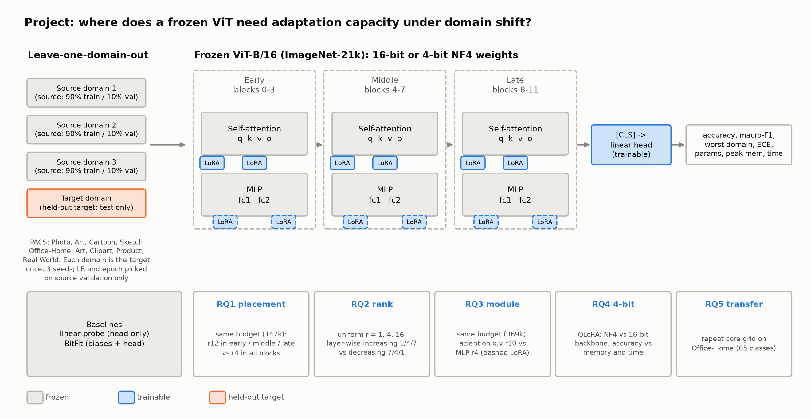
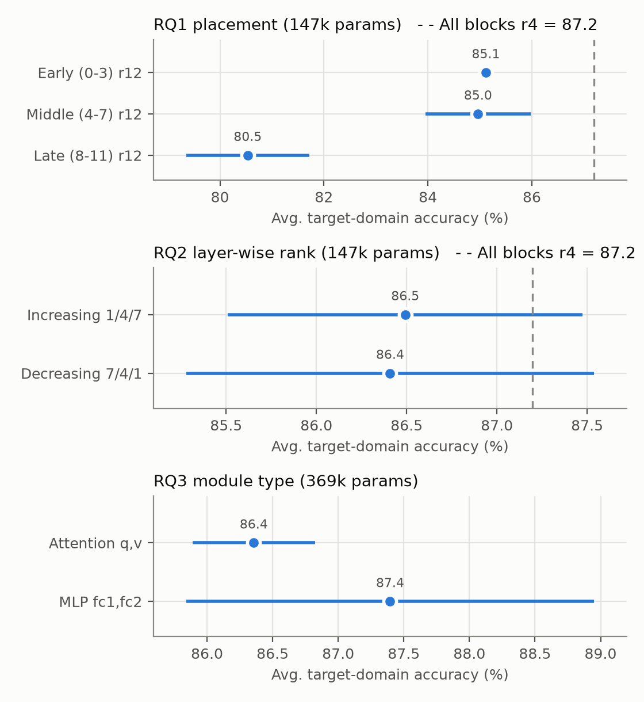
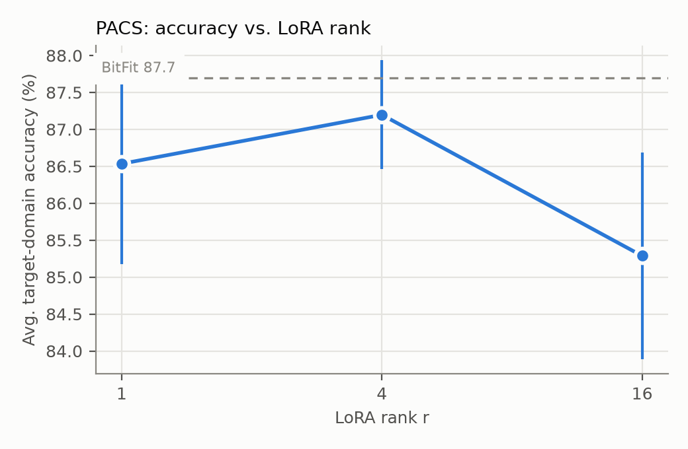
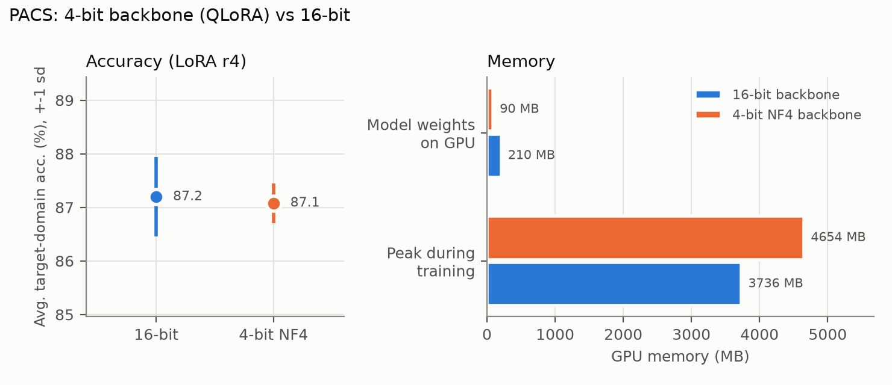
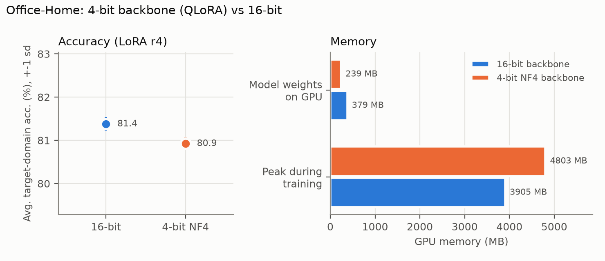
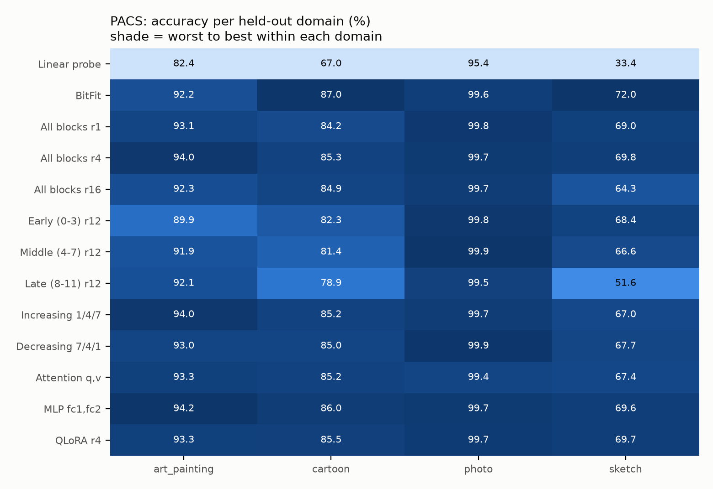
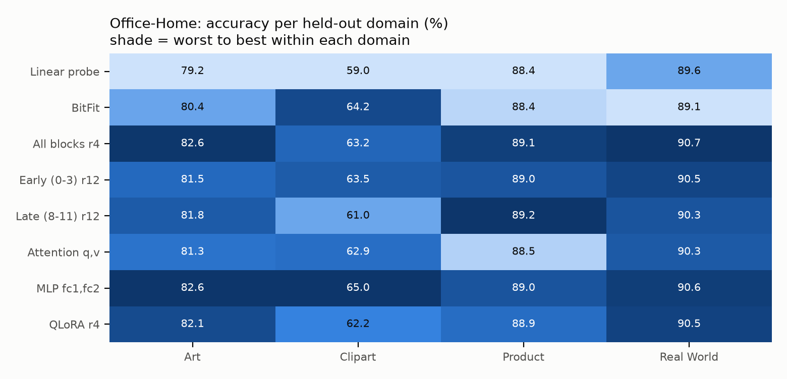
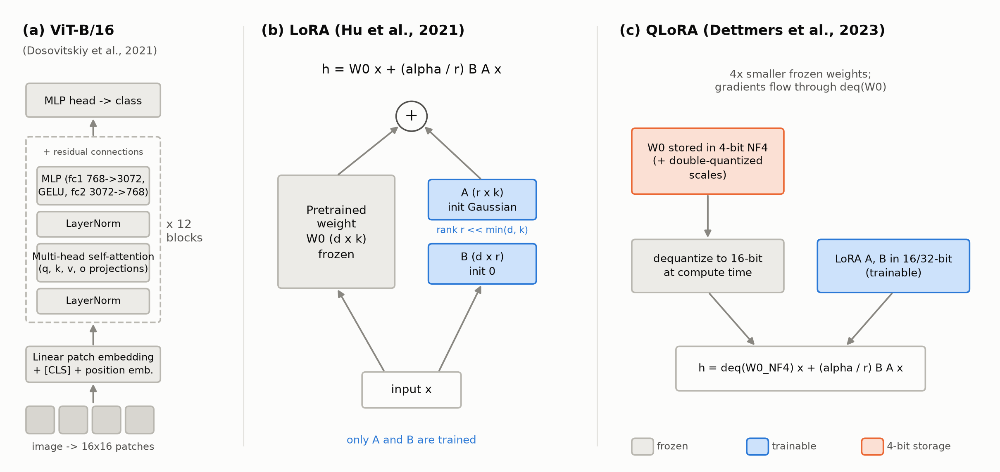

# Where does a Vision Transformer need adaptation capacity under domain shift?

A controlled study of **LoRA placement, layer-wise rank, attention vs. MLP adapters, and 4-bit (QLoRA)
compression** on a frozen ViT-B/16, evaluated leave-one-domain-out on **PACS** and **Office-Home**.

Image classifiers lose accuracy when the visual style changes (photo to sketch, product shot to clipart).
Parameter-efficient fine-tuning adapts a frozen pretrained model with a few trainable parameters. LoRA is the
usual choice, but it is normally applied with one fixed rank in every layer, a recipe inherited from language
models. This project asks *where* inside a ViT that capacity actually helps under domain shift, at matched
parameter budgets.



## Which file should I open?

| You want to | Open | Training needed? |
|---|---|---|
| See the results and a live demo | **`demo_results.ipynb`** (already executed, so its outputs are visible on GitHub) | No, runs in a few minutes on CPU |
| Classify your own images | **`predict.py`** with the trained adapter in `model/` | No |
| Re-run the whole study | `vit_dg.py` (see [Reproduce](#reproduce)) | Yes, about 11 GPU-hours |

```
pip install -r requirements.txt
jupyter notebook demo_results.ipynb      # results tables, significance tests, figures, live predictions
python predict.py                        # classify the images in demo_images/
```

## Key findings

| Question | Finding (PACS, 3 seeds x 4 held-out domains) | Office-Home |
|---|---|---|
| **RQ1** Placement (same 147k budget) | Spreading rank 4 over all 12 blocks is best. Early-only -2.1, middle-only -2.2, **late-only -6.7 points** (worst on Sketch: 51.6% vs 69.8%). Late-only uses 60% less memory. | Same order, smaller gaps (late -0.8, p=0.03) |
| **RQ2** Rank | Rank 1 is within 0.7 points of rank 4; rank 16 is 1.9 points *lower*. Increasing (1/4/7) or decreasing (7/4/1) depth profiles do not beat uniform rank. | not run (reduced grid) |
| **RQ3** Attention vs MLP (same 369k budget) | MLP adapters +1.0 points (8/12 paired wins), best calibration; ~30% more memory. | MLP +1.1 points, 12/12 wins (p=0.004) |
| **RQ4** 4-bit NF4 backbone (QLoRA) | Accuracy -0.1 points (n.s.); weights 210 MB to 90 MB; **peak training memory +25%**, training 23% slower. | -0.45 points (consistent); peak memory +23% |
| **RQ5** Transfer | The trends hold on Office-Home with smaller gaps. BitFit is best on PACS but below LoRA on Office-Home. | |

At ViT-B scale, activations rather than weights dominate training memory, so QLoRA's memory saving (designed for
billion-parameter language models) does not carry over.

## Results

### PACS (Tesla T4)

Average target-domain accuracy (%) over 4 held-out domains, mean +- sd over 3 seeds.

| Method | Avg acc | Worst domain (Sketch) | Macro-F1 | Trainable params (excl. head) | Peak memory | Train time / run |
|---|---|---|---|---|---|---|
| Linear probe | 69.5 +- 0.8 | 33.4 | 72.3 | 0 | 0.84 GB | 91 s |
| BitFit | **87.7 +- 0.3** | **72.0** | 88.3 | 103k | 3.07 GB | 182 s |
| LoRA all blocks, r=1 | 86.5 +- 1.4 | 69.0 | 87.1 | 37k | 3.66 GB | 207 s |
| LoRA all blocks, r=4 | 87.2 +- 0.7 | 69.8 | 87.8 | 147k | 3.65 GB | 202 s |
| LoRA all blocks, r=16 | 85.3 +- 1.4 | 64.3 | 86.0 | 590k | 3.66 GB | 204 s |
| Early blocks 0-3, r=12 | 85.1 +- 0.1 | 68.4 | 85.6 | 147k | 3.21 GB | 185 s |
| Middle blocks 4-7, r=12 | 85.0 +- 1.0 | 66.6 | 85.7 | 147k | 2.34 GB | 153 s |
| Late blocks 8-11, r=12 | 80.5 +- 1.2 | 51.6 | 81.8 | 147k | 1.47 GB | 121 s |
| Increasing rank 1/4/7 | 86.5 +- 1.0 | 67.0 | 87.3 | 147k | 3.64 GB | 206 s |
| Decreasing rank 7/4/1 | 86.4 +- 1.1 | 67.7 | 87.0 | 147k | 3.64 GB | 206 s |
| Attention q,v, r=10 | 86.4 +- 0.5 | 67.4 | 86.9 | 369k | 3.65 GB | 205 s |
| MLP fc1,fc2, r=4 | 87.4 +- 1.6 | 69.6 | 88.3 | 369k | 4.81 GB | 245 s |
| QLoRA r=4 (4-bit NF4) | 87.1 +- 0.4 | 69.7 | 87.6 | 147k | 4.55 GB | 249 s |

### Office-Home (AMD Radeon RX 9070 GRE)

| Method | Avg acc | Worst domain (Clipart) | Macro-F1 | Trainable params (excl. head) | Peak memory | Train time / run |
|---|---|---|---|---|---|---|
| Linear probe | 79.0 +- 0.1 | 59.0 | 78.0 | 0 | 1.03 GB | 91 s |
| BitFit | 80.5 +- 0.2 | 64.2 | 79.4 | 103k | 3.26 GB | 150 s |
| LoRA all blocks, r=4 | 81.4 +- 0.2 | 63.2 | 80.4 | 147k | 3.81 GB | 170 s |
| Early blocks 0-3, r=12 | 81.1 +- 0.3 | 63.5 | 80.0 | 147k | 3.37 GB | 152 s |
| Late blocks 8-11, r=12 | 80.6 +- 0.2 | 61.0 | 79.6 | 147k | 1.63 GB | 115 s |
| Attention q,v, r=10 | 80.7 +- 0.2 | 62.9 | 79.8 | 369k | 3.78 GB | 170 s |
| MLP fc1,fc2, r=4 | **81.8 +- 0.1** | **65.0** | 80.7 | 369k | 4.93 GB | 216 s |
| QLoRA r=4 (4-bit NF4) | 80.9 +- 0.1 | 62.2 | 80.0 | 147k | 4.69 GB | 223 s |

Memory and time are comparable within a dataset only (different GPUs). Paired t-tests over the 12 matched
(target, seed) runs are in `results/*_paired_tests.csv`.

### Budget-matched comparisons (PACS)



### Accuracy vs. LoRA rank (PACS)



### 4-bit backbone vs. 16-bit




### Accuracy per held-out domain




## Method



- **Backbone:** `google/vit-base-patch16-224-in21k` (ViT-B/16, ImageNet-21k), all weights frozen, 16-bit
  (or 4-bit NF4 with double quantization for QLoRA). A new linear head on the [CLS] token is always trained.
- **LoRA:** `h = W0 x + (alpha/r) B A x`, alpha = 2r, dropout 0.1. The 12 blocks are split into early (0-3),
  middle (4-7) and late (8-11) thirds, and each configuration sets a rank per third and per module type.
- **Budget matching:** rank 12 in one third = rank 4 in all blocks = increasing/decreasing profiles
  (147,456 adapter parameters); attention q,v r=10 = MLP fc1,fc2 r=4 (368,640). Check with
  `python vit_dg.py --model vit_b --grid pacs_core --dry_run`.
- **Baselines:** linear probe (head only) and BitFit (all biases + head).
- **Protocol:** leave-one-domain-out. The three source domains are split 90/10 into train/validation (fixed
  split); the held-out target domain is test only. Learning rate and best epoch are chosen on **source
  validation only**. 3 seeds x 4 target domains per configuration.
- **Training:** AdamW (weight decay 0.01, 0 for BitFit), batch 64, 4 epochs, 5% warm-up + cosine decay, label
  smoothing 0.1, mixed precision; random resized crop, flip, color jitter.
- **Learning rates:** tuned per method from {1e-3, 3e-3, 1e-2} on one split; both datasets selected 1e-2 for the
  linear probe and BitFit and 3e-3 for LoRA (shared by all LoRA/QLoRA variants).
- **Metrics:** target accuracy, macro-F1, worst-domain accuracy, expected calibration error, trainable
  parameters, peak GPU memory (`torch.cuda.max_memory_allocated`), training time.

## Using the trained model

`model/pacs_mlp4_sketch_s0/` is a trained LoRA adapter (1.5 MB): rank 4 on the MLP layers of all 12 blocks of a
frozen ViT-B/16, plus the 7-class head. It was trained on PACS **photo, art painting and cartoon only**; the
**sketch** domain was held out and reaches **76.6%** accuracy on all 3,929 sketch images. The frozen backbone
(`google/vit-base-patch16-224-in21k`) is downloaded from the Hugging Face Hub on first use.

```
python predict.py                              # demo_images/: 7 photos (training domain) + 14 unseen sketches
python predict.py path/to/drawing.png          # your own images
```

Example output on `demo_images/` (19/21 correct):

```
photo_elephant.png           -> elephant   92.4%  correct
sketch_dog_1.png             -> person     87.6%  WRONG (true: dog)
sketch_giraffe_2.png         -> giraffe    91.8%  correct
sketch_guitar_1.png          -> guitar     91.0%  correct
sketch_house_1.png           -> house      94.1%  correct
```

Classes: dog, elephant, giraffe, guitar, horse, house, person. To train and save another adapter:
`python vit_dg.py --dataset pacs --configs mlp4 --targets sketch --seeds 0 --lrs 0.003 --epochs 4 --save_dir model`.

## Repository contents

| Path | What |
|---|---|
| `demo_results.ipynb` | Results tables, significance tests, figures and live predictions, without training |
| `predict.py` | Classify images with the trained adapter |
| `model/pacs_mlp4_sketch_s0/` | Trained LoRA adapter + head (sketch held out) |
| `demo_images/` | 7 PACS photos and 14 PACS sketches for the demo (`export_demo_images.py` writes them) |
| `vit_dg.py` | Experiments: dataset caching, LODO splits, linear probe / BitFit / LoRA / QLoRA, metrics, resumable job runner |
| `analyze.py` | Summary tables, paired t-tests and result figures |
| `make_tables.py` | LaTeX versions of the results tables |
| `make_arch_figs.py` | Architecture diagrams `fig1_base_paper_architecture.png`, `fig2_project_architecture.png` |
| `kaggle_run.py` | Runs the PACS grid on Kaggle GPUs (push / status / pull) |
| `run_local_officehome.sh` | Runs the Office-Home grid on a local GPU |
| `figures/` | All figures |
| `results/` | Per-run results (`*.jsonl`), summaries (`*_summary.csv/.md`), paired tests |
| `run_outputs/` | Training logs |

## Reproduce

```
pip install -r requirements.txt

# parameter budgets of every configuration
python vit_dg.py --model vit_b --grid pacs_core --dry_run

# LR tuning on one split, then the grid (3 seeds); datasets download from the Hugging Face Hub
python vit_dg.py --dataset pacs --grid tune --lrs 1e-3 3e-3 1e-2 --seeds 0 --targets art_painting --epochs 4
python vit_dg.py --dataset pacs --grid pacs_core --seeds 0 1 2 --tuned_from pacs --epochs 4
sh run_local_officehome.sh            # same two steps for Office-Home

# tables and figures
python analyze.py --dataset pacs --epochs 4
python analyze.py --dataset officehome --epochs 4
python make_tables.py
python make_arch_figs.py
```

`vit_dg.py` skips runs that are already in the output file, so an interrupted grid can simply be restarted.
Use `--shard i/n` to split a grid across GPUs.

## Limitations

- One backbone (ViT-B/16, ImageNet-21k) and two benchmarks; no full fine-tuning reference.
- A short 4-epoch schedule chosen for the compute budget; learning rates tuned on a single split.
- Office-Home uses a reduced set of 8 configurations.
- PACS ran on Tesla T4 GPUs and Office-Home on an RX 9070 GRE, so absolute memory and time are only compared
  within a dataset. One PACS run (QLoRA, Photo target, seed 2) ran on the RX 9070 GRE and is used for
  accuracy only.
- Several differences are within seed noise; see the paired tests before drawing conclusions.

## Training environment

- PACS: Kaggle, 2x NVIDIA Tesla T4, fp16 autocast.
- Office-Home: AMD Radeon RX 9070 GRE, Windows 11, PyTorch 2.9.1 + ROCm 7.2.1, fp16 autocast.
- transformers 5.23.0, peft 0.21.3, bitsandbytes 0.50.2.

## Datasets

- **PACS** (Li et al., ICCV 2017): 9,991 images, 7 classes, domains Photo, Art painting, Cartoon, Sketch.
  [`flwrlabs/pacs`](https://huggingface.co/datasets/flwrlabs/pacs)
- **Office-Home** (Venkateswara et al., CVPR 2017): 15,588 images, 65 classes, domains Art, Clipart, Product,
  Real World. [`flwrlabs/office-home`](https://huggingface.co/datasets/flwrlabs/office-home)

## References

- Hu et al., *LoRA: Low-Rank Adaptation of Large Language Models*, [arXiv:2106.09685](https://arxiv.org/abs/2106.09685)
- Dettmers et al., *QLoRA: Efficient Finetuning of Quantized LLMs*, [arXiv:2305.14314](https://arxiv.org/abs/2305.14314)
- Dosovitskiy et al., *An Image is Worth 16x16 Words*, [arXiv:2010.11929](https://arxiv.org/abs/2010.11929)
